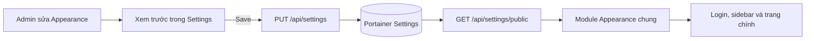

# Tùy chỉnh giao diện Portainer

Tài liệu này dành cho quản trị viên và developer sử dụng bản Portainer CE tùy chỉnh.
Quản trị viên có thể thay đổi thương hiệu, màu, font và bố cục trong **Settings → Appearance**.
Thay đổi được lưu trong Settings của Portainer; không cần build image lại mỗi lần cấu hình.

## Hướng dẫn cho quản trị viên

1. Đăng nhập bằng tài khoản administrator, mở **Settings → Appearance**.
2. Trong **Branding**, nhập tên hiển thị, URL logo và URL favicon. Tên rỗng hiển thị `Portainer`.
   Logo nên có kích thước khoảng 155 × 55 px; favicon nên là ảnh vuông. URL ảnh phải truy cập được
   từ trình duyệt của người sử dụng. Favicon chấp nhận URL HTTP(S) hoặc đường dẫn tuyệt đối
   cùng origin, ví dụ `/favicon.png`. URL logo dùng quy tắc URL hiện có của Portainer.
3. Trong **Colors**, lần lượt chọn Light và Dark, nhập các màu nhấn, nền trang, nền card và
   nền sidebar theo dạng `#RRGGBB`. Để trống trường bất kỳ để kế thừa màu mặc định.
   Ví dụ Light: accent `#2458A6`, page `#F4F6FA`, card `#FFFFFF`, sidebar `#202C40`.
4. Trong **Typography**, chọn Inter, System UI hoặc Arial và cỡ chữ 100%, 110% hoặc 120%.
   System UI và Arial có thể hiển thị khác giữa các hệ điều hành; editor/terminal tiếp tục dùng monospace.
5. Trong **Layout and theme**, chọn chiều rộng sidebar 240–360 px, trạng thái sidebar mặc định,
   Standard/Compact và theme mặc định. Chọn **Preview theme** và **Preview width** để xem mẫu.
6. Kiểm tra mẫu với Light và Dark rồi nhấn **Save appearance**. Bản xem trước nằm trong trang
   Settings và không thay đổi giao diện đang dùng trước khi lưu.

**Cancel** khôi phục bản đã lưu vào biểu mẫu. **Reset to defaults** chỉ thay đổi biểu mẫu;
nhấn **Save appearance** để áp dụng và xóa cả URL logo tùy chỉnh. Mặc định là Portainer,
logo/favicon hiện tại của sản phẩm, font Inter 100%, theme System, sidebar 300 px/mở và Standard.

Nếu một phiên khác cập nhật Appearance trong khi bạn đang chỉnh, biểu mẫu giữ bản nháp,
thông báo xung đột và tạm khóa Save. Chọn **Reload saved appearance** (hoặc Cancel)
để bỏ bản nháp và tải cấu hình mới nhất đã nhận. Khi chưa sửa biểu mẫu, dữ liệu mới
được tự cập nhật. Trong lúc Settings đang tải lại, Save tạm thời bị khóa.

Theme mặc định áp dụng khi chưa đăng nhập hoặc tài khoản chưa chọn theme. Tài khoản đã chọn
Light, Dark, System hoặc High Contrast giữ lựa chọn đó. High Contrast luôn giữ bảng màu chuẩn;
tên, logo và font vẫn được áp dụng. Người dùng đã tự mở/thu gọn sidebar trên trình duyệt giữ
lựa chọn của mình; màn hình nhỏ và Docker Desktop có quy tắc thu gọn riêng. Dòng
**Powered by Portainer** được giữ khi dùng logo riêng.

Lưu thành công áp dụng ngay cho phiên quản trị hiện tại. Những trình duyệt khác nhận cấu hình
mới khi tải lại trang. Không có cơ chế tự đẩy thay đổi tới phiên đang mở.

### Xử lý lỗi hiển thị

- Không thấy logo/favicon: kiểm tra URL từ chính trình duyệt người dùng, HTTPS và cache của trình duyệt.
  Logo hỏng chuyển sang logo Portainer; favicon hỏng khôi phục icon mặc định.
- Cỡ chữ bị chật: thử 100% hoặc Standard, kiểm tra cả điện thoại và desktop trước khi lưu.
- Màu khó đọc: kiểm tra cả Light/Dark trong preview, rồi kiểm tra thực tế với tài khoản có quyền
  tương ứng. Nếu cần phục hồi nhanh, dùng Reset và Save; có thể đăng nhập từ thiết bị khác để sửa.
- Không thấy thay đổi sau khi lưu: tải lại trình duyệt. Theme và trạng thái sidebar cá nhân có thể
  ghi đè mặc định của admin. High Contrast không áp dụng bảng màu tùy chỉnh.
- Nếu tải public settings thất bại khi đã có cache ứng dụng, giao diện dùng mặc định cho tới lần tải thành công.

### Minh họa luồng áp dụng



## Giao diện API

`GET /api/settings` và `PUT /api/settings` yêu cầu quyền admin. `GET /api/settings/public`
trả các dữ liệu trình bày cần cho trang đăng nhập; không đặt bí mật trong tên hoặc URL.
`LogoURL` là trường cũ dùng chung; Appearance không có trường logo thứ hai.
Mỗi lần gửi `Appearance` phải gửi đầy đủ object. Các request cập nhật Settings khác không gửi
Appearance sẽ không thay đổi cấu hình này.

Ví dụ body của `PUT /api/settings` (sử dụng xác thực admin thông thường):

```json
{
  "LogoURL": "https://example.com/logo.png",
  "Appearance": {
    "Branding": { "Name": "Example Operations", "FaviconURL": "/favicon.png" },
    "Colors": {
      "Light": { "Accent": "#2458A6", "PageBackground": "#F4F6FA", "SurfaceBackground": "#FFFFFF", "SidebarBackground": "#202C40" },
      "Dark": { "Accent": "#A6C9FF", "PageBackground": "#121820", "SurfaceBackground": "#202A35", "SidebarBackground": "#101820" }
    },
    "Typography": { "FontFamily": "inter", "FontScale": 100 },
    "Layout": { "SidebarWidth": 300, "SidebarDefault": "open", "Density": "standard" },
    "DefaultTheme": "auto"
  }
}
```

Khôi phục hoàn toàn bằng body sau (hoặc dùng Reset và Save trong giao diện):

```json
{
  "LogoURL": "",
  "Appearance": {
    "Branding": { "Name": "Portainer", "FaviconURL": "" },
    "Colors": {
      "Light": { "Accent": "", "PageBackground": "", "SurfaceBackground": "", "SidebarBackground": "" },
      "Dark": { "Accent": "", "PageBackground": "", "SurfaceBackground": "", "SidebarBackground": "" }
    },
    "Typography": { "FontFamily": "inter", "FontScale": 100 },
    "Layout": { "SidebarWidth": 300, "SidebarDefault": "open", "Density": "standard" },
    "DefaultTheme": "auto"
  }
}
```

## Hướng dẫn developer

Backend lưu object Appearance tùy chọn trong Settings, kiểm tra giá trị trước khi lưu cùng
LogoURL và trả cấu hình hiệu lực qua public settings. Dữ liệu cũ không có Appearance dùng
mặc định mà không cần migration. Chỉ dữ liệu trình bày công khai được đưa vào API public.

`app/react/portainer/appearance/appearance.ts` chuẩn hóa cấu hình, đặt các CSS variables và
áp dụng favicon. `applyTheme.ts` chọn palette theo theme cá nhân/hệ thống; High Contrast bỏ
qua màu tùy chỉnh. Angular StateManager lấy lại public settings và gọi cùng module mà React
sử dụng. CSS chung nằm ở `app/assets/css/appearance.css`; chiều rộng sidebar dùng biến CSS.
Các selector có `data-appearance-*` là opt-in, vì vậy màu mặc định không bị thay đổi.

Khi thêm một token, cập nhật model Go, kiểm tra dữ liệu backend, public response, types
frontend, phần apply/reset và preview. Dùng biến theo vai trò, không thay màu success/error,
không đưa CSS tùy ý từ API vào DOM. Đổi theme cần dọn token của palette trước đó.
Các theme màu và font cần được kiểm tra ở cả Angular lẫn React.

Chạy theo toolchain của repo, ví dụ `go test ./api/http/handler/settings`,
`pnpm exec vitest run <test-file>`, `pnpm typecheck`, `pnpm exec eslint <changed-files>`
và `pnpm build`. Xác minh trên trình duyệt là một bước riêng: login/logout, Home,
sidebar, bảng, form, modal, cả Light/Dark/High Contrast và các chiều rộng 390/768/1440 px.
Build thành công không chứng minh kết quả ở trình duyệt hoặc production.
